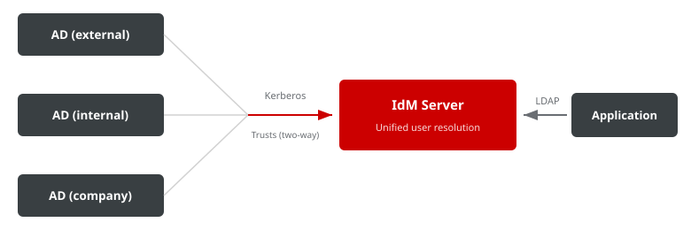
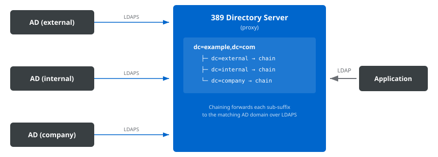

# RHEL AD LDAP Proxy

> **Disclaimer:** This project is provided as-is for testing and demonstration purposes only. It is not officially supported in any way. No guarantees are made regarding its functionality, reliability, or suitability for any environment. The author assumes no responsibility or liability for any issues, damages, or consequences arising from its use. Use at your own risk.

Ansible playbooks for setting up an LDAP proxy that fronts multiple Active Directory domains, providing a single authentication endpoint for LDAP-capable applications. Two approaches are available depending on whether IdM is present in the environment.

## Prerequisites

```bash
ansible-galaxy collection install -r common/requirements.yml
```

All Windows Server VMs should be prepared from a sysprepped base image using the playbook in `common/sysprep/`.

## Use Cases

### 1. [IDM - AD Proxy](idm-ad-proxy/)

Three AD domains fronted by IdM as a unified authentication endpoint. IdM trusts each domain and resolves users via the `cn=users,cn=compat` tree, without needing POSIX group mappings.



**Best for:** An LDAP-capable application needs a single endpoint to authenticate users from multiple AD forests, and IdM is already deployed.

### 2. [DS - AD Proxy](ds-ad-proxy/)

Three AD domains fronted by a 389 Directory Server instance that chains LDAP queries to each domain over LDAPS. No IdM required. The proxy presents a single `dc=example,dc=com` tree with one sub-suffix per AD domain.



**Best for:** An LDAP-capable application needs unified LDAP access to multiple AD forests, and there is no IdM in the environment.

## Shared Components (`common/`)

| Directory | Contents |
|---|---|
| `common/tasks/` | Shared Ansible task files for DC deployment, user/group creation, and `/etc/hosts` management |
| `common/sysprep/` | Windows Server base image preparation (sysprep + unattend) |
| `common/requirements.yml` | Ansible collection dependencies |

## Sysprep

Prepares a base Windows Server VM image. Run once, then clone the resulting qcow2 for each AD domain controller.

```bash
ansible-playbook -i <inventory> common/sysprep/generalize-base-image.yml
```
